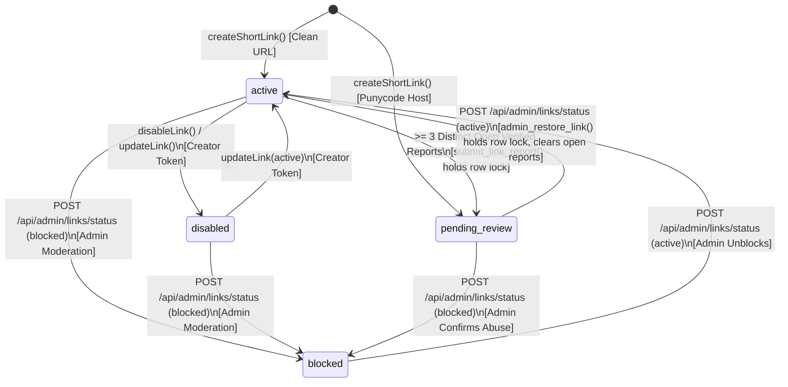

# T-00033 — Link Shortener: Design Document

**Task:** T-00033 · Link Shortener — design the link service + abuse controls
**Design partner:** Saiyam Gupta
**Author:** Engineering
**Status:** PROPOSED ARCHITECTURE & DESIGN SPECIFICATION (Final Targeted Revision)
**Branch:** `feat/t-00033-link-shortener`
**Last updated:** 2026-11-24

---

## Table of Contents

1. [Overview & Scope](#1-overview--scope)
2. [Glossary & Terminology Mapping](#2-glossary--terminology-mapping)
3. [Goals, Non-goals & Boundary Limits](#3-goals-non-goals--boundary-limits)
4. [Baseline Audit & Existing State](#4-baseline-audit--existing-state)
5. [Requirements](#5-requirements)
6. [Data Model Evolution](#6-data-model-evolution)
7. [Service & API Contracts](#7-service--api-contracts)
8. [Redirect Architecture & Route Design](#8-redirect-architecture--route-design)
9. [Reserved Slugs & Collision Handling](#9-reserved-slugs--collision-handling)
10. [Abuse Prevention & Security Controls](#10-abuse-prevention--security-controls)
11. [ADR-1: Datastore Selection](#11-adr-1-datastore-selection)
12. [ADR-2: Redirect Execution Layer](#12-adr-2-redirect-execution-layer)
13. [Modular Architecture & Code Organization](#13-modular-architecture--code-organization)
14. [Threat → Control → Test Matrix](#14-threat--control--test-matrix)
15. [Status State Machine & Moderation Flow](#15-status-state-machine--moderation-flow)
16. [Observability, Telemetry & Privacy](#16-observability-telemetry--privacy)
17. [Rollout & Rollback Strategy](#17-rollout--rollback-strategy)
18. [Confirmed Repository Facts vs Assumptions](#18-confirmed-repository-facts-vs-assumptions)
19. [Remaining Unresolved Questions for Team Confirmation](#19-remaining-unresolved-questions-for-team-confirmation)

---

## 1. Overview & Scope

Marvedge Tools (`Final_tools_Marv`) already provides a functional link shortener tool at `/link-shortener` backed by a `short_links` table in Supabase PostgreSQL, routing short URLs through `/go/:code`.

Task **T-00033** hardens and extends this existing service. The service is evolved in-place to introduce real HTTP 302 redirects, robust validation, redirect-target safety, domain reputation checks, modular fixed-window rate limiting, creator-scoped token management, and public reporting with admin moderation.

### Confirmed In-Scope Features
- **Creator-based link management:** High-entropy token-based authentication allowing creators to view stats and disable or modify their links without requiring user registration.
- **Link disabling:** Soft disabling by creators or administrative blocking.
- **Public abuse reporting:** Abuse report submission with rate limiting, signed session fallback, and deduplication.
- **Admin moderation:** Dedicated server-to-server HTTP API endpoints to list reports, update report statuses, take action on links, and maintain domain blocklists.
- **Abuse prevention:** Target URL safety validation, homograph detection, and rate limiting.
- **Backward compatibility:** Existing password protection, expiry, custom slugs, and active links continue to operate seamlessly.

### Explicitly Out-of-Scope
- **Demo Script Generator & AI Product Description tools:** These exist on separate tool pages (`demo-script-generator`, `product-description-generator`) and do not interface with the link shortener service. Confirmed out of scope for T-00033.
- **Full user authentication system:** No user accounts, OAuth sign-ins, or session management are introduced for link creators in v1.
- **Dedicated short vanity domain:** Short links remain at `${origin}/go/:code` for v1.

---

## 2. Glossary & Terminology Mapping

| Task Vocabulary | Codebase & DB Name | Description |
|-----------------|--------------------|-------------|
| **Slug** | `code` | Unique path parameter in `/go/:code`. Pattern: `^[A-Za-z0-9_-]{3,40}$`. |
| **Target URL** | `url` | The destination URL to which clients are redirected. Max 2048 characters. |
| **Creator Token** | `creatorToken` / `creator_token_hash` | Secret 32-byte CSPRNG token (base64url). Database stores strictly `hex(SHA-256(rawBytes))`. |
| **Status** | `status` | Link lifecycle state: `'active'`, `'disabled'`, `'blocked'`, `'pending_review'`. |
| **Report Status** | `status` (in `link_reports`) | Moderation review state: `'open'`, `'reviewed'`, `'actioned'`, `'dismissed'`. |
| **IP Hash** | `reporter_hash` / rate limit key | Salted hash `SHA-256(IP_HASH_SALT + client_ip)` or signed session identifier. Raw IPs are never persisted. |

---

## 3. Goals, Non-goals & Boundary Limits

### Architectural Goals
1. **Real HTTP 302 Redirects:** Eliminate client-side JavaScript redirects (`window.location.replace`) across all navigation paths—initial clean hits, password unlocks, and interstitial continuations.
2. **Reliable Datastore:** Keep Supabase PostgreSQL as the authoritative single source of truth.
3. **Target URL Safety:** Validate destination URLs to prevent visitors from being redirected to private network endpoints, loopback addresses, or cloud metadata services.
4. **Creator Autonomy Without Accounts:** Issue high-entropy CSPRNG creator tokens to manage links, storing only cryptographic hashes.
5. **Modular Rate Limiting:** Implement fixed-window rate limiting in PostgreSQL for v1 behind a modular interface allowing future transition to distributed cache layers (e.g., Redis) without rewriting service logic.
6. **Separation of Concerns:** Keep core link domain logic in pure TypeScript modules (`src/lib/links/`) free of browser or Vite-specific runtime globals to ensure standalone unit-testability.

### Non-goals
- Introducing Redis, Upstash, or external caching infrastructure in v1.
- Migrating the app or shortener to Next.js, Express, or standalone microservices.
- Automated blocking or deletion of links without administrative review.

---

## 4. Baseline Audit & Existing State

A comprehensive repository inspection and baseline check conducted during Step 0 revealed the following state:

### Stack Architecture
- **Framework:** TanStack Start 1.168.60 + TanStack Router 1.170.41 + React 19 + Vite 8.1.5 + Nitro (`NITRO_PRESET=netlify`).
- **Database:** Supabase PostgreSQL managed via service role client (`src/integrations/supabase/client.server.ts`).
- **Migrations:** Drizzle SQL files in `drizzle/migrations/` tracked by `drizzle/migrations/meta/_journal.json`. Existing initial migration: `0000_create_short_links.sql`.
- **Global Middleware:** `src/start.ts` registers global CSRF protection (`createCsrfMiddleware`) filtering for server functions (`filter: (ctx) => ctx.handlerType === "serverFn"`).

### Pre-Existing Repository Baseline Issues
The following failures exist on `main` / pristine baseline before any changes:
1. **Linter (`npm run lint`):** Produces 23,450 Prettier errors (`Delete ␍`) due to Windows CRLF checkout versus repository-configured LF expectations.
2. **Test Runner (`npm test`):** All 6 test suites crash on startup (`TypeError: Cannot read properties of undefined (reading 'config')`). Vitest runs in JSDOM where Vite virtual modules and TanStack Start runtime configs (`getStartOptions`, `import.meta.env.TSS_SERVER_FN_BASE`) are not injected.
3. **Build (`npm run build`):** Fails during client rollup with 4 unresolved import errors in `pdf-lib/es/index.js` sub-paths due to Rolldown/Vite 8 module resolution.

> [!IMPORTANT]
> These issues represent pre-existing repository technical debt. T-00033 will **not** refactor unrelated tools or broad linter configs. All new code created in `src/lib/links/` must use LF line endings and be written as pure, decoupled modules to execute cleanly under unit tests.

### Vulnerability Analysis of Existing Link Shortener
- **Client-Side Redirect:** `src/routes/go.$code.tsx` performs navigation via `window.location.replace(r.url)` inside a React loader/component, returning a 200 HTML page rather than an HTTP 302.
- **Pseudo-Random Slugs:** Codes generated via `Math.random().toString(36).slice(2, 9)` without collision retries or cryptographic entropy.
- **Timing Vulnerabilities:** Password comparison in `src/lib/links.functions.ts` uses JavaScript standard string equality (`!==`), exposing a timing side-channel.
- **Click Race Condition:** Clicks are tracked via `update({ clicks: row.clicks + 1 })` on a stale read rather than an atomic database increment.
- **Incomplete Validation:** Target URL validation relies solely on a basic regex (`/^https?:\/\//i`), omitting WHATWG parsing, port restrictions, or private network checks.
- **Lack of Governance:** No rate limits, no slug reservation, no domain blocklist, and no creator update/delete mechanism.

---

## 5. Requirements

### 5.1 Functional Requirements

- **FR-01: HTTP 302 Redirect:** `GET /go/:code` must return a real HTTP 302 with `Location: {url}` for active, non-expired, unprotected links.
- **FR-02: Security Headers:** Redirect responses must include `Cache-Control: no-store`, `Referrer-Policy: no-referrer`, and `X-Robots-Tag: noindex`.
- **FR-03: Password Protection:** Protected links must return HTTP 200 presenting an unlock form. Verification is handled via server POST action with constant-time hash comparison, emitting a real server-side HTTP 302 redirect upon success without client-side JS navigation.
- **FR-04: Expiration Handling:** Expired links must return HTTP 410. Expiration must be evaluated dynamically (`expires_at < now()`).
- **FR-05: Missing & Inactive Statuses:** Non-existent codes return HTTP 404. Disabled and blocked links return HTTP 410. Links flagged as `pending_review` display an interstitial notice informing visitors the link is pending moderation. The "Continue to Target" action executes a server POST returning a direct HTTP 302.
- **FR-06: Creator Token Management:** `createShortLink` must return a 32-byte CSPRNG token (base64url) shown once to the creator. The database stores only `hex(SHA-256(rawBytes))`.
- **FR-07: Creator Actions:** With a valid token, creators can query link stats (`getLinkInfo`), toggle status (`active` ↔ `disabled`), update expiry, or clear/set a password.
- **FR-08: Public Reporting:** Anyone can submit an abuse report for a code. Reports are rate-limited and deduplicated per reporter hash.
- **FR-09: Non-Disruptive Escalation:** Accumulation of reports ($\ge 3$ distinct verified reporter hashes on **`open`** status reports) flags the link as `pending_review` for administrator attention. **Dismissed reports are excluded from escalation, and links are never automatically blocked or disabled by report volume alone.**
- **FR-10: Admin Moderation:** Administrators authenticate via `ADMIN_API_KEY` on dedicated server HTTP endpoints (`/api/admin/links/*`) to list reports, update report statuses (`reviewed`, `actioned`, `dismissed`), override link statuses (`active`, `disabled`, `blocked`, `pending_review`), and manage domain blocklists.
- **FR-11: Blocklist Re-Check:** Blocked domains must be checked at creation time and re-validated at redirect time.
- **FR-12: Reliable Serverless Click Counting:** Clicks are tracked via an awaited atomic SQL procedure (`register_click()`) before issuing redirects, guaranteeing durability in serverless runtimes across initial hits, password submissions, and interstitial continuations.

### 5.2 Non-Functional Requirements

- **NFR-01: Performance:** Redirect resolution overhead must remain under 100ms warm on Supabase PostgreSQL.
- **NFR-02: Rate Limiting Overhead:** Atomic rate check must execute within a single SQL round-trip.
- **NFR-03: Privacy:** Zero raw IP addresses stored in PostgreSQL or application logs. All IP references use salted cryptographic hashes (`IP_HASH_SALT`).
- **NFR-04: Secret Hygiene:** Service role keys and admin API keys must never be exposed to browser bundles or logged in application traces. Creator tokens are intentionally delivered once to the creator in the private JSON response payload of `createShortLink` and stored in client `localStorage`, but must never be embedded in static build bundles or logged on the server.

---

## 6. Data Model Evolution

All schema changes are additive to ensure zero downtime and complete backward compatibility with existing links.

### 6.1 Evolving `public.short_links`

```sql
-- Migration: 0001_harden_short_links.sql

ALTER TABLE public.short_links
  ADD COLUMN IF NOT EXISTS status text NOT NULL DEFAULT 'active'
    CHECK (status IN ('active', 'disabled', 'blocked', 'pending_review')),
  ADD COLUMN IF NOT EXISTS creator_token_hash text,
  ADD COLUMN IF NOT EXISTS updated_at timestamptz DEFAULT now(),
  ADD COLUMN IF NOT EXISTS last_clicked_at timestamptz,
  ADD COLUMN IF NOT EXISTS target_host text;

-- Constraints
ALTER TABLE public.short_links
  ADD CONSTRAINT short_links_url_length CHECK (char_length(url) <= 2048),
  ADD CONSTRAINT short_links_expiry_order CHECK (expires_at IS NULL OR expires_at > created_at);

-- Partial and targeted indexes
CREATE INDEX IF NOT EXISTS short_links_status_idx ON public.short_links (status);
CREATE INDEX IF NOT EXISTS short_links_expires_at_idx ON public.short_links (expires_at)
  WHERE expires_at IS NOT NULL;
CREATE INDEX IF NOT EXISTS short_links_target_host_idx ON public.short_links (target_host);
```

### 6.2 Supporting Tables

#### `public.link_reports`
Stores abuse reports submitted by users. `reporter_hash` is non-nullable to ensure the unique constraint deduplicates consistently without PostgreSQL `NULL` bypasses.

```sql
CREATE TABLE public.link_reports (
  id uuid PRIMARY KEY DEFAULT gen_random_uuid(),
  code text NOT NULL REFERENCES public.short_links(code) ON DELETE CASCADE,
  reason text NOT NULL CHECK (reason IN ('phishing', 'malware', 'spam', 'illegal', 'other')),
  details text CHECK (char_length(details) <= 1000),
  reporter_hash text NOT NULL, -- Salted hash: SHA-256(IP_HASH_SALT + client_ip) OR signed session sentinel
  status text NOT NULL DEFAULT 'open' CHECK (status IN ('open', 'reviewed', 'actioned', 'dismissed')),
  created_at timestamptz NOT NULL DEFAULT now(),
  CONSTRAINT link_reports_code_reporter_unique UNIQUE (code, reporter_hash)
);

GRANT ALL ON public.link_reports TO service_role;
ALTER TABLE public.link_reports ENABLE ROW LEVEL SECURITY;
```

#### `public.blocked_domains`
Maintains blocked domains. Application logic performs suffix and exact matching.

```sql
CREATE TABLE public.blocked_domains (
  domain text PRIMARY KEY,
  source text NOT NULL DEFAULT 'manual',
  added_at timestamptz NOT NULL DEFAULT now()
);

GRANT ALL ON public.blocked_domains TO service_role;
ALTER TABLE public.blocked_domains ENABLE ROW LEVEL SECURITY;

INSERT INTO public.blocked_domains (domain, source) VALUES
  ('malware-example.test', 'seed'),
  ('phishing-example.test', 'seed')
ON CONFLICT (domain) DO NOTHING;
```

#### `public.rate_limits`
Fixed-window rate limit table keyed by action and hashed identifier.

```sql
CREATE TABLE public.rate_limits (
  key text NOT NULL,
  window_start timestamptz NOT NULL,
  count int NOT NULL DEFAULT 0,
  PRIMARY KEY (key, window_start)
);

GRANT ALL ON public.rate_limits TO service_role;
ALTER TABLE public.rate_limits ENABLE ROW LEVEL SECURITY;
```

### 6.3 Stored Procedures & Atomic Functions

All functions are declared `SECURITY DEFINER` and pin `search_path = public` to mitigate privilege escalation.

#### `public.rate_limit_hit` — Fixed-Window Rate Limiter
Validates parameters strictly and performs atomic increment and window accounting using epoch-aligned fixed windows.

```sql
CREATE OR REPLACE FUNCTION public.rate_limit_hit(
  p_key text,
  p_window_seconds int,
  p_limit int
) RETURNS TABLE(allowed bool, remaining int, retry_after int)
LANGUAGE plpgsql SECURITY DEFINER SET search_path = public
AS $$
DECLARE
  v_window timestamptz;
  v_count int;
  v_elapsed int;
BEGIN
  -- Strict parameter validation
  IF p_window_seconds IS NULL OR p_window_seconds <= 0 THEN
    RAISE EXCEPTION 'p_window_seconds must be a positive integer';
  END IF;
  IF p_limit IS NULL OR p_limit <= 0 THEN
    RAISE EXCEPTION 'p_limit must be a positive integer';
  END IF;
  IF p_key IS NULL OR length(trim(p_key)) = 0 THEN
    RAISE EXCEPTION 'p_key cannot be empty';
  END IF;

  -- Epoch-aligned fixed time window
  v_window := date_trunc('second', now())
    - (EXTRACT(EPOCH FROM now())::bigint % p_window_seconds) * interval '1 second';

  INSERT INTO rate_limits (key, window_start, count)
    VALUES (p_key, v_window, 1)
    ON CONFLICT (key, window_start)
    DO UPDATE SET count = rate_limits.count + 1
    RETURNING count INTO v_count;

  v_elapsed := EXTRACT(EPOCH FROM (now() - v_window))::int;

  RETURN QUERY SELECT
    (v_count <= p_limit) AS allowed,
    GREATEST(0, p_limit - v_count) AS remaining,
    CASE WHEN v_count > p_limit
      THEN GREATEST(1, p_window_seconds - v_elapsed)
      ELSE 0
    END AS retry_after;
END;
$$;

REVOKE ALL ON FUNCTION public.rate_limit_hit(text, int, int) FROM PUBLIC;
GRANT EXECUTE ON FUNCTION public.rate_limit_hit(text, int, int) TO service_role;
```

#### `public.register_click`
Executes an atomic click count and updates `last_clicked_at`. Increments clicks for both `'active'` links and `'pending_review'` links (when a visitor proceeds past the interstitial).

```sql
CREATE OR REPLACE FUNCTION public.register_click(p_code text)
RETURNS void LANGUAGE sql SECURITY DEFINER SET search_path = public
AS $$
  UPDATE short_links
     SET clicks = clicks + 1,
         last_clicked_at = now()
   WHERE code = p_code
     AND status IN ('active', 'pending_review')
     AND (expires_at IS NULL OR expires_at > now());
$$;

REVOKE ALL ON FUNCTION public.register_click(text) FROM PUBLIC;
GRANT EXECUTE ON FUNCTION public.register_click(text) TO service_role;
```

#### `public.submit_link_report` — Atomic Locked Submission & Escalation
Acquires an exclusive row lock on `short_links` to serialize report submission with concurrent moderation actions, recalculates open verified reports while holding the lock, and safely applies escalation.

```sql
CREATE OR REPLACE FUNCTION public.submit_link_report(
  p_code text,
  p_reason text,
  p_details text,
  p_reporter_hash text
) RETURNS TABLE(ok bool, already_reported bool, escalated bool)
LANGUAGE plpgsql SECURITY DEFINER SET search_path = public AS $$
DECLARE
  v_status text;
  v_open_count int;
BEGIN
  -- 1. Acquire row lock on short_links to serialize moderation and report concurrency
  SELECT status INTO v_status
    FROM short_links
   WHERE code = p_code
     FOR UPDATE;

  IF NOT FOUND THEN
    RETURN QUERY SELECT false, false, false;
    RETURN;
  END IF;

  -- 2. Insert report with deduplication handling
  BEGIN
    INSERT INTO link_reports (code, reason, details, reporter_hash, status)
      VALUES (p_code, p_reason, p_details, p_reporter_hash, 'open');
  EXCEPTION WHEN unique_violation THEN
    -- Already reported by this verified reporter hash
    RETURN QUERY SELECT true, true, false;
    RETURN;
  END;

  -- 3. Calculate open verified reports while holding the short_links lock
  SELECT COUNT(DISTINCT reporter_hash) INTO v_open_count
    FROM link_reports
   WHERE code = p_code
     AND status = 'open'
     AND reporter_hash NOT LIKE 'unverified:%';

  -- 4. Transition to pending_review if threshold reached and currently active
  IF v_open_count >= 3 AND v_status = 'active' THEN
    UPDATE short_links
       SET status = 'pending_review',
           updated_at = now()
     WHERE code = p_code;
    RETURN QUERY SELECT true, false, true;
  ELSE
    RETURN QUERY SELECT true, false, false;
  END IF;
END;
$$;

REVOKE ALL ON FUNCTION public.submit_link_report(text, text, text, text) FROM PUBLIC;
GRANT EXECUTE ON FUNCTION public.submit_link_report(text, text, text, text) TO service_role;
```

#### `public.admin_restore_link` — Atomic Moderation Reset
Acquires the exact same row lock on `short_links` before restoring status and clearing open reports, eliminating moderation race conditions.

```sql
CREATE OR REPLACE FUNCTION public.admin_restore_link(p_code text)
RETURNS void LANGUAGE plpgsql SECURITY DEFINER SET search_path = public
AS $$
DECLARE
  v_existing text;
BEGIN
  -- 1. Acquire same row lock order on short_links
  SELECT status INTO v_existing
    FROM short_links
   WHERE code = p_code
     FOR UPDATE;

  IF NOT FOUND THEN
    RETURN;
  END IF;

  -- 2. Atomically update link status and transition open reports to reviewed
  UPDATE short_links
     SET status = 'active',
         updated_at = now()
   WHERE code = p_code;

  UPDATE link_reports
     SET status = 'reviewed'
   WHERE code = p_code
     AND status = 'open';
END;
$$;

REVOKE ALL ON FUNCTION public.admin_restore_link(text) FROM PUBLIC;
GRANT EXECUTE ON FUNCTION public.admin_restore_link(text) TO service_role;
```

#### `public.cleanup_rate_limits`
Prunes expired rate limit records older than 2 hours.

```sql
CREATE OR REPLACE FUNCTION public.cleanup_rate_limits()
RETURNS int LANGUAGE sql SECURITY DEFINER SET search_path = public
AS $$
  WITH deleted AS (
    DELETE FROM rate_limits WHERE window_start < now() - interval '2 hours'
    RETURNING 1
  )
  SELECT count(*)::int FROM deleted;
$$;

REVOKE ALL ON FUNCTION public.cleanup_rate_limits() FROM PUBLIC;
GRANT EXECUTE ON FUNCTION public.cleanup_rate_limits() TO service_role;
```

---

## 7. Service & API Contracts

### 7.1 Public & Creator Functions (`src/lib/links.functions.ts`)

These are TanStack Start server functions (`createServerFn`) called from browser client components, protected by global CSRF middleware (`createCsrfMiddleware` in `src/start.ts`).

#### `createShortLink`
- **Method:** POST RPC (CSRF protected)
- **Input:** `{ url: string, code?: string, password?: string, expiresAt?: string }`
- **Output:**
  - Success: `{ ok: true, code: string, creatorToken: string }`
  - Error: `{ ok: false, error: "taken" | "reserved" | "invalid_url" | "blocked_domain" | "rate_limited" | "server_error", retryAfter?: number }`

#### `resolveShortLink`
- **Method:** POST RPC (CSRF protected)
- **Input:** `{ code: string, password?: string }`
- **Output:**
  - `{ status: "ok", url: string }`
  - `{ status: "password" }`
  - `{ status: "password_pending_review" }` (Protected + flagged: prompt password with warning; **no URL disclosed yet**)
  - `{ status: "expired" }`
  - `{ status: "missing" }`
  - `{ status: "wrong" }`
  - `{ status: "disabled" }`
  - `{ status: "blocked" }`
  - `{ status: "pending_review", url: string }` (Unlocked: displays interstitial notice with destination URL)
  - `{ status: "rate_limited", retryAfter: number }`

#### `getLinkInfo`
- **Method:** POST RPC (CSRF protected)
- **Input:** `{ code: string, creatorToken: string }`
- **Output:**
  - Success: `{ ok: true, code: string, url: string, status: string, clicks: number, createdAt: string, expiresAt: string | null, lastClickedAt: string | null }`
  - Error: `{ ok: false, error: "not_found" | "unauthorized" | "rate_limited" }`

#### `updateLink`
- **Method:** POST RPC (CSRF protected)
- **Input:** `{ code: string, creatorToken: string, expiresAt?: string | null, status?: "active" | "disabled", password?: string | null }`
- **Output:** `{ ok: true } | { ok: false, error: "not_found" | "unauthorized" | "rate_limited" | "server_error" }`

#### `disableLink`
- Convenience wrapper over `updateLink({ status: "disabled" })`.

#### `reportLink`
- **Method:** POST RPC (CSRF protected)
- **Input:** `{ code: string, reason: "phishing" | "malware" | "spam" | "illegal" | "other", details?: string }`
- **Output:** `{ ok: true, alreadyReported?: boolean } | { ok: false, error: "not_found" | "rate_limited" | "unverified_client" }`
- **Escalation Policy:** Handled atomically in PostgreSQL via `submit_link_report()`. If `count(distinct reporter_hash) >= 3` on **unresolved (`status = 'open'`) verified reports**, the link's status is updated to `'pending_review'`. Dismissed reports and unverified fallback reports do not count toward this threshold.

---

### 7.2 Administrative API & Dedicated Server Route Handlers

> [!CAUTION]
> **Dedicated Machine-to-Machine Boundary & CSRF Decoupling:**
> In `src/start.ts`, TanStack Start's `createCsrfMiddleware` explicitly filters requests: `filter: (ctx) => ctx.handlerType === "serverFn"`.
> To avoid CSRF token mismatches on external CLI/curl/backend automation calls, **admin moderation operations are implemented as dedicated server HTTP route handlers under `/api/admin/links/*`**, NOT as browser-callable `createServerFn` RPCs.
>
> **Authentication & Hygiene Rules:**
> 1. Gated strictly by `x-admin-api-key` header verified via `crypto.timingSafeEqual` against the server-only `ADMIN_API_KEY` environment variable.
> 2. `ADMIN_API_KEY` is strictly server-to-server. It is **never** prefixed with `VITE_` or included in frontend client bundles.
> 3. Browser frontend components must never prompt for, store, or transmit `ADMIN_API_KEY`.
> 4. Any future administrative web dashboard must run behind a user session authentication guard (e.g., Supabase Auth with admin role claims verified via server middleware) that proxies moderation actions on the server, rather than transmitting a shared secret from browser JS.

#### Route Structure in TanStack Start
The dedicated admin HTTP routes are defined in the file-based route tree:
- **`src/routes/api.admin.links.reports.ts`:**
  - `GET`: Lists paginated reports (`status`, `limit`, `offset`).
  - `PATCH`: Updates an abuse report's status (`reportId`, `status: "reviewed" | "actioned" | "dismissed"`).
- **`src/routes/api.admin.links.status.ts`:**
  - `POST`: Updates short link status (`code`, `status`, `addDomain`). If restoring to `'active'`, executes `admin_restore_link()` transactionally.
- **`src/routes/api.admin.links.blocked-domains.ts`:**
  - `POST`: Inserts a domain into `blocked_domains` (`domain`, `source`).

All handlers define `createFileRoute(...)({ server: { handlers: { ... } } })` and enforce `x-admin-api-key` validation immediately before processing.

---

## 8. Redirect Architecture & Route Design

### 8.1 Comparison of TanStack Start Server Route Capabilities

During Step 0, two concrete redirect architectures were analyzed in the installed TanStack Start package:

| Criteria | Approach A: `loader → throw redirect()` (Recommended v1) | Approach B: `server.handlers.GET` |
|----------|---------------------------------------------------------|-----------------------------------|
| **Location** | Defined inside `createFileRoute("/go/$code")({ loader })` | Defined inside `createFileRoute("/go/$code")({ server: { handlers: { GET } } })` |
| **Response** | Throws `redirect({ href, statusCode: 302, headers })` caught by TanStack SSR handler | Returns standard `Response(null, { status: 302, headers })` |
| **UI Integration** | Seamlessly coexists with Route Component rendering password form, 410, and 404 pages | Bypasses SSR lifecycle entirely; requires explicit routing logic to hand over non-redirect paths to React |
| **Latency** | Single SSR lifecycle execution | Marginally lower (skips Router SSR instantiation on clean 302) |
| **Availability** | Confirmed available and functional in v1.168.60 | Confirmed available in `serverRoute.d.ts` in v1.168.60 |

**Recommendation:** Use **Approach A (`loader → throw redirect()`) for v1**. It cleanly unifies redirect decisions, password forms, and error states in a single route definition without requiring artificial delegation back into React rendering. Approach B is documented as an optimization path if microsecond redirect benchmarks warrant it.

### 8.2 Redirect Decision Matrix & Password + Review Interaction

When a link is both **password-protected** and flagged as **`pending_review`**, authentication takes precedence to protect the destination URL from unauthorized disclosure, but the review warning is displayed prominently throughout:

```
[Visitor Navigates to /go/flagged-code]
          │
          ▼
Is password required?
   ├── YES ──► Render Password Unlock Form WITH Flag Warning Banner
   │           (Target URL is NOT disclosed in HTML or payload)
   │                  │
   │                  ▼
   │           Visitor enters correct password via POST /go/:code
   │                  │
   │                  ▼
   └── NO  ──► Render Interstitial Warning Notice
               ("This link was flagged for community review. Destination: [url]")
                      │
                      ▼
               Visitor submits [Continue to Target] via POST /go/:code
                      │
                      ▼
               Server revalidates link status & target safety
                      │
                      ▼
               await register_click(code)  <-- Awaited for durability
                      │
                      ▼
               Server emits HTTP 302 Redirect Response (Location: {url})
```

| Link State | Initial GET HTTP Status | Form POST Action & Server Redirect Flow |
|------------|-------------------------|-----------------------------------------|
| `active`, unexpired, no password | **302** | Initial GET awaits `register_click(code)` → returns HTTP 302 `Location: target`. |
| `active`, unexpired, password set | **200** | Renders unlock form. Password submission POSTs to `/go/:code` → server validates password in constant time → awaits `register_click(code)` → returns server **HTTP 302** `Location: target`. |
| Password submitted & incorrect | **200** | Form re-renders with inline error message (rate-limited). |
| `pending_review` (unprotected) | **200** | Interstitial warning page. Continue button POSTs to `/go/:code` → server revalidates link → awaits `register_click(code)` → returns server **HTTP 302** `Location: target`. |
| `pending_review` + password | **200** | Renders password form with warning badge (no URL disclosed). Valid password POST renders destination interstitial → Continue POST awaits `register_click(code)` → returns server **HTTP 302**. |
| `expired` (`expires_at < now()`) | **410** | Gone page: "This short link has expired." |
| `disabled` | **410** | Gone page: "This link has been disabled by its creator." |
| `blocked` | **410** | Gone page: "This link has been removed due to policy violations." |
| Code not found in database | **404** | Not Found page. |
| Rate limit exceeded | **429** | Error page with `Retry-After` header. |
| Target domain in blocklist | **410** | Gone page (blocked on access). |

### 8.3 Zero Client-Side Navigation Guarantee
In all redirect scenarios (initial clean hits, password unlocks, and interstitial continuations), **the client browser never executes `window.location.replace` or client-side navigation**. Every redirection is emitted directly by the server as an HTTP 302 response with headers:
```http
HTTP/1.1 302 Found
Location: https://destination.example.com/target
Cache-Control: no-store
Referrer-Policy: no-referrer
X-Robots-Tag: noindex
```
This guarantees that preview bots, HTTP clients, and standard browsers receive native HTTP redirects while ensuring 100% click counting durability via awaited database updates.

---

## 9. Reserved Slugs & Collision Handling

To prevent short links from colliding with system routes, existing tools, or critical assets, all slug assignments (custom or generated) must be checked against a reserved registry.

### 9.1 Composition of Reserved Set (`src/lib/links/reserved.ts`)
The reserved slug set is composed dynamically at module initialization:
1. **Static System Slugs:** `api`, `admin`, `login`, `logout`, `signup`, `auth`, `report`, `health`, `healthz`, `status`, `static`, `assets`, `favicon`, `robots`, `sitemap`, `well-known`, `about`, `terms`, `privacy`, `docs`, `help`, `support`, `www`, `app`, `dashboard`, `settings`, `go`, `unlock`, `blocked`, `expired`, `marvedge`, `new`, `null`, `undefined`, `_next`, `index`, `__root`.
2. **Dynamic Tool Slugs:** Automatically mapped from `tools.map(t => t.slug)` in `src/lib/tools.ts` (19 existing tools).
3. **Route & Asset Names:** File routes in `src/routes/` and static assets in `public/`.
4. **Brand Impersonation List:** Minimal static list of lookalike deceptive terms (`paypa1`, `g00gle`, `amaz0n`, `app1e`).

### 9.2 Regression Unit Test
A dedicated unit test (`src/test/links-reserved.test.ts`) validates that every tool slug in `tools.ts` is rejected by `isReservedSlug()`. If an engineer adds a tool to `tools.ts` in the future, the test enforces that the slug is protected against link hijacking.

### 9.3 Cryptographic Generation & Collision Retries
Generated codes are 7 characters long using base62 (`[A-Za-z0-9]`), produced via `crypto.getRandomValues`. If a generated slug collides with an existing record or reserved term:
- The system retries generation up to **5 times**.
- If 5 consecutive collisions occur, it aborts cleanly with a `server_error`.

---

## 10. Abuse Prevention & Security Controls

### 10.1 Destination Safety Validation (`src/lib/links/url-policy.ts`)

> [!NOTE]
> **Safety Context:** The Marvedge server does not fetch or proxy target URLs; it merely returns HTTP 302 headers to user browsers. However, open redirects to private network addresses or cloud metadata endpoints can be weaponized against local intranets, home routers, and developer sandboxes. Target safety validation prevents Marvedge from serving as an open redirect vector into private network topologies.

Validation pipeline executed on all URLs:
1. **Length Check:** Maximum 2048 characters.
2. **Whitespace & Control Characters:** Stripped and rejected if control codes exist.
3. **WHATWG Parser:** URL must parse successfully via standard `new URL(url)`.
4. **Scheme Whitelist:** Only `http:` and `https:` are permitted. Schemes such as `javascript:`, `data:`, `file:`, `ftp:`, `vbscript:`, and `blob:` are strictly rejected.
5. **Credentials Check:** Disallow embedded credentials (`username` or `password` in authority).
6. **Host Validation:** Host must be present and cannot be empty.
7. **Private IP & Loopback Rejection:**
   - IPv4 loopback (`127.0.0.0/8`, `0.0.0.0`).
   - RFC 1918 private ranges (`10.0.0.0/8`, `172.16.0.0/12`, `192.168.0.0/16`).
   - Link-local and cloud metadata (`169.254.0.0/16`, `metadata.google.internal`).
   - IPv6 loopback and private ranges (`::1`, `fc00::/7`, `fe80::/10`).
   - Octal, decimal, and hexadecimal encoded IP representations (e.g., `0177.1`, `2130706433`).
8. **Self-Origin Loop Prevention:** Target host cannot match `PUBLIC_SITE_URL` host, and path cannot begin with `/go/`.
9. **Shortener Chaining:** Allowed by default. Can be blocked via optional configuration `BLOCK_SHORTENER_CHAINS=true` matching known shorteners (`bit.ly`, `tinyurl.com`, `t.co`, `ow.ly`).
10. **Homograph / Punycode Detection:** Hosts containing `xn--` are accepted but automatically flagged with `status = 'pending_review'`.
11. **Normalization:** Hostnames lowercased, default ports (`:80`, `:443`) stripped, empty fragments omitted.

---

### 10.2 Trusted Client IP Extraction & Signed Session Cookie Policy (`src/lib/links/ip.server.ts`)

#### Extraction Hierarchy & Trusted Proxy Guard
1. **Netlify Edge IP Header:** `x-nf-client-connection-ip` is injected and sanitized at the Netlify edge. It is the authoritative, trusted source in production.
2. **`x-forwarded-for` Guard:** `x-forwarded-for` is **only** inspected if Netlify headers are absent (e.g., local development). In production, arbitrary `x-forwarded-for` headers are treated as untrusted because untrusted clients can forge upstream IP headers.
3. **Unverified Reporting Session Cookie Specification:**
   - When no trustworthy client IP can be established (`x-nf-client-connection-ip` missing or invalid):
     - **Key Derivation:** The server derives a dedicated 32-byte signing secret $K_{\text{sess}}$ using HKDF-SHA256 from `IP_HASH_SALT` with info `"mrv-link-shortener-reporting-session-v1"` (or reads `REPORTING_SESSION_SECRET` if provided), avoiding raw salt reuse:
       $$K_{\text{sess}} = \text{HKDF-Expand}(\text{Extract}(\text{IP\_HASH\_SALT}), \text{"mrv-link-shortener-reporting-session-v1"}, 32)$$
     - **Session ID Generation & Entropy:** 16 cryptographically secure random bytes generated via `crypto.getRandomValues(new Uint8Array(16))` and encoded as URL-safe base64 (128 bits of entropy).
     - **Cookie Structure & Lifetime:**
       ```
       _mrv_rep_sess = ${sessionId}.${expiresAtTimestamp}.${hmacHex}
       ```
       where `expiresAtTimestamp = Date.now() + 7200000` (2-hour rolling lifetime) and `hmacHex = HMAC-SHA256(K_sess, `${sessionId}.${expiresAtTimestamp}`)`.
     - **Cookie Attributes:** `HttpOnly; Secure; SameSite=Lax; Path=/; Max-Age=7200`.
     - **Issuance:** Automatically issued via `Set-Cookie` on GET `/go/:code` if trusted IP is absent and no valid session cookie is present.
     - **Constant-Time Verification:** When an unverified client submits a report, the cookie is parsed, expiration checked (`expiresAtTimestamp > Date.now()`), and signature verified in constant time via `crypto.timingSafeEqual`.
     - **Handling Invalid/Expired Cookies:** If missing, expired, or tampered, the report submission is rejected with error `'unverified_client'`.
     - **Session Rate Limiting:** Enforces a per-session limit of **2 reports per hour** tracked in `rate_limits` under key `report_session:${sessionId}`.
     - **Deterministic Reporting Hash:** Unverified reports record `reporter_hash = 'unverified:' || sessionId`.
     - **Auto-Escalation Safeguard:** Reports bearing `reporter_hash LIKE 'unverified:%'` are **strictly excluded** from the distinct reporter count threshold ($\ge 3$) required to automatically transition a link to `pending_review`. They appear only in the admin review queue for manual inspection.

#### Salted IP Hashing
Raw IP strings are never stored or logged. Salted SHA-256 is applied before keying:
$$\text{ipHash} = \text{SHA-256}(\text{IP\_HASH\_SALT} + \text{clientIp})$$
If `IP_HASH_SALT` is missing in production, the application throws a fatal configuration exception on startup.

---

### 10.3 Password Hashing & Constant-Time Comparison (`src/lib/links/password.ts`)

- **Format:** `pbkdf2$sha256$<iterations>$<saltHex>$<hashHex>`
- **Iteration Count:** Default floor of **300,000 iterations** of PBKDF2 with SHA-256. Tested under Netlify Node 20 runtime constraints (< 300ms execution).
- **Constant-Time Verification:** Uses `crypto.timingSafeEqual` over fixed-width byte buffers.
- **Legacy Upgrade:** Passwords stored in legacy `saltHex:hashHex` format are verified against 100,000 iterations upon login, and on success, automatically re-hashed to the new versioned format and updated in the database.

---

### 10.4 Creator Token Security & Storage Model (`src/lib/links/token.ts`)

- **Generation:** 32 bytes of CSPRNG entropy generated as `Uint8Array(32)` via `crypto.getRandomValues`.
- **Delivery:** Delivered to creator as URL-safe base64 string (`base64url(rawBytes)`) in the private HTTP JSON response of `createShortLink`.
- **Storage in Database:** Stored in `short_links.creator_token_hash` strictly as `hex(SHA-256(rawBytes))`.
- **Client Storage & XSS Threat Model:**
  - The client UI stores `{ code, creatorToken }` in browser `localStorage` to allow creators to revisit `/link-shortener` and manage their active links across sessions.
  - *Threat Trade-off:* Data in `localStorage` is accessible to JavaScript executing on the same origin. A cross-site scripting (XSS) vulnerability on the domain could allow token extraction. Because Marvedge Tools is a client-side utility suite with a strict Content Security Policy, zero user-generated HTML rendering, and no third-party ad tags, this risk is acceptable for v1 to avoid the complexity of full user accounts, email verification, and session cookies.
- **Verification Workflow:**
  1. Incoming `creatorToken` base64url string is decoded into its original 32 raw bytes (`Uint8Array(32)`).
  2. Compute `hex(SHA-256(rawBytes))`.
  3. Compare computed hex against `creator_token_hash` using `crypto.timingSafeEqual`.
- **Recovery Limitations:** If a creator clears their browser storage or loses their token, the service provides no self-service recovery (no associated email or password). The link can only be altered by an administrator.

---

## 11. ADR-1: Datastore Selection

**Decision:** Retain **Supabase PostgreSQL** as the single source of truth for all short links, reports, blocklists, and fixed-window rate limits in v1. Do not introduce Redis or external key-value stores.

### Evaluation Summary

| Architecture | Operational Complexity | Cost | Latency (p95) | ACID / Integrity |
|--------------|------------------------|------|---------------|------------------|
| **Supabase PostgreSQL (v1 Choice)** | Low (existing) | Free tier included | ~50–120ms | Full (PK constraints, atomic functions) |
| Postgres + Upstash / Redis | High (dual data sync) | Additional tier | ~20–40ms | Eventual (requires cache invalidation) |
| Netlify Blobs / KV | Medium | Platform-bound | ~30–60ms | Weak (no relational integrity or atomic increments) |

### Explicit Triggers for Adding a Cache Layer (v2)
A caching layer (Redis / Upstash) will only be introduced if at least one of the following concrete thresholds is breached in production:
1. Measured redirect resolution p95 latency exceeds **300ms** over a sustained 7-day period.
2. Redirect traffic exceeds **500 requests per minute**, causing PostgreSQL connection exhaustion.
3. Supabase free-tier egress or CPU limits reach 80% capacity.

---

## 12. ADR-2: Redirect Execution Layer

**Decision:** Implement the redirect using the **TanStack Start route loader** (`throw redirect({ href, statusCode: 302 })`) hosted on the **Netlify SSR Function** (`/.netlify/functions/server`) for v1.

### Technical Analysis
- TanStack Start routes all server functions and loaders through Nitro on Netlify.
- Step 0 verified that returning/throwing a redirect from `src/routes/go.$code.tsx` causes the SSR engine to short-circuit HTML rendering and emit an immediate HTTP 302 response with custom headers.
- While `route.server.handlers.GET` is confirmed to exist in `@tanstack/start-client-core`, using the `loader` pattern provides seamless fallback to React-rendered views (password unlock forms, 410 Gone notices, 404 Not Found) without manual stream/response splitting.

### Long-Term Edge Migration Path (v2 Scale Path)
If sub-30ms global redirect latency is required in the future:
1. Deploy a lightweight **Netlify Edge Function** mounted at `/go/*`.
2. Query Supabase directly via lightweight edge fetch.
3. If active and unprotected, emit an edge HTTP 302. If password-protected or errored, proxy through to the TanStack Start SSR function.

---

## 13. Modular Architecture & Code Organization

To guarantee unit testability without relying on the broken baseline JSDOM/Vite virtual runtime, all domain logic is isolated in pure TypeScript modules:

```
src/
├── lib/
│   ├── links/                  <-- Pure modules (Vitest-testable without Vite globals)
│   │   ├── url-policy.ts       # WHATWG parsing, scheme validation, private IP check
│   │   ├── reserved.ts         # Reserved slug registry and validator
│   │   ├── slug.ts             # Base62 CSPRNG generator with collision retry
│   │   ├── password.ts         # Versioned PBKDF2 hash, verify & legacy upgrade
│   │   ├── token.ts            # Creator token byte decoding, hashing & constant-time verify
│   │   ├── blocklist.ts        # Domain suffix matcher & UrlReputationProvider interface
│   │   ├── ratelimit.server.ts # Server-side rate limiter adapter calling SQL function
│   │   └── ip.server.ts        # Netlify trusted IP extractor & signed session cookie validator
│   └── links.functions.ts      # Client-facing TanStack createServerFn RPCs (CSRF protected)
├── routes/
│   ├── api.admin.links.reports.ts         # Dedicated Admin API: GET / PATCH reports
│   ├── api.admin.links.status.ts          # Dedicated Admin API: POST status (calls admin_restore_link)
│   ├── api.admin.links.blocked-domains.ts # Dedicated Admin API: POST blocked domains
│   └── go.$code.tsx                       # HTTP 302 loader redirect, unlock form & continue handler
└── components/
    └── tools/
        └── LinkShortener.tsx   # Creator UI: token display, local storage management, reports
```

---

## 14. Threat → Control → Test Matrix

| Threat / Attack Vector | Security Control | Verification Test Suite |
|------------------------|------------------|-------------------------|
| Open redirect to private LAN / metadata | `url-policy.ts` rejects private, link-local, loopback & cloud metadata IPs | `src/test/links-url-policy.test.ts` |
| Malicious schemes (`javascript:`, `data:`) | Strict whitelist (`http:`, `https:` only) | `src/test/links-url-policy.test.ts` |
| Slug hijacking of tool pages | `reserved.ts` checks against `tools.ts` and static routes | `src/test/links-reserved.test.ts` |
| Password hash timing side-channel | `crypto.timingSafeEqual` comparison | `src/test/links-password.test.ts` |
| Click count undercounting under load | Awaited atomic PostgreSQL update via `register_click()` | `src/test/links-service.test.ts` |
| Password brute-forcing | Rate limit: 5 attempts per 15 min per IP/code | `src/test/links-service.test.ts` |
| Report flooding from single source | Deduplication via `(code, reporter_hash)` unique constraint | `src/test/links-service.test.ts` |
| Disruption via false report brigades | Only open, verified reports count toward escalation; unverified IPs excluded | `src/test/links-service.test.ts` |
| Unauthorized admin modification | Constant-time `ADMIN_API_KEY` verification on dedicated server HTTP routes | `src/test/links-service.test.ts` |
| Creator token interception | Raw token never in build bundles; raw bytes decoded & SHA-256 hash stored | `src/test/links-token.test.ts` |
| Moderation race condition | `admin_restore_link` and `submit_link_report` serialize on `short_links` row lock | `src/test/links-service.test.ts` |

---

## 15. Status State Machine & Moderation Flow



### Abuse Reports & Moderation Concurrency Lifecycle
1. **Report Submission:** Handled by `submit_link_report(p_code, p_reason, p_details, p_reporter_hash)`.
   - Acquires `SELECT status FROM short_links WHERE code = p_code FOR UPDATE`.
   - Inserts the report with unique deduplication.
   - Recalculates verified open report count while holding the row lock. If $\ge 3$ and currently `'active'`, updates status to `'pending_review'`.
2. **Visitor Experience during Review:** Unauthenticated visitors see an informational interstitial warning note with the option to proceed. If password-protected, the password form is presented first with a warning badge, preventing destination URL leakage until authenticated.
3. **Transactional Moderation Resolution:**
   - The administrator reviews open reports via `GET /api/admin/links/reports`.
   - If abuse is confirmed: Admin calls `POST /api/admin/links/status` (`status: "blocked"`, `addDomain: true`), and updates reports via `PATCH /api/admin/links/reports` (`status: "actioned"`).
   - If link is benign: Admin calls `POST /api/admin/links/status` (`status: "active"`). The backend executes `admin_restore_link(code)` transactionally:
     - Acquires the same `SELECT status FROM short_links WHERE code = p_code FOR UPDATE` lock.
     - Atomically updates `short_links.status = 'active'` and all open reports for that code to `'reviewed'`.
     - Because both `submit_link_report` and `admin_restore_link` serialize on the exact same row lock, no race window exists where a concurrent report could read stale open reports and immediately re-flag the link.

---

## 16. Observability, Telemetry & Privacy

### Structured Server Logs
Logged events emit sanitized JSON without PII:
- **`link_created`**: `{ code, target_host, has_password, has_expiry, status }`
- **`redirect_resolved`**: `{ code, status, latency_ms }`
- **`rate_limit_exceeded`**: `{ action, retry_after }`
- **`report_filed`**: `{ code, reason, distinct_open_reporters }`
- **`admin_action`**: `{ code, action, new_status }`

**Explicitly Excluded from Logs:** Raw URLs with query parameters, plain passwords, creator tokens, raw client IP addresses, and `ADMIN_API_KEY`.

---

## 17. Rollout & Rollback Strategy

### Rollout Steps
1. **Apply SQL Migration `0001_harden_short_links.sql`:** Additive columns and new tables are created in Supabase PostgreSQL. Existing links receive `status = 'active'`.
2. **Configure Environment Variables in Netlify:**
   - `ADMIN_API_KEY`: Strong random secret (`openssl rand -hex 32`).
   - `IP_HASH_SALT`: Strong random secret for client IP anonymization and reporting session signatures.
   - `PUBLIC_SITE_URL`: Configured to `https://marvedge.com` (provisional).
3. **Deploy Application:**
   - Updated `src/lib/links/` modules, server functions, and dedicated admin server routes go live.
   - Existing short links continue redirecting without interruption.
4. **Post-Deployment Verification:**
   - Verify unauthenticated link creation and creator token output.
   - Verify HTTP 302 response and headers via `curl -I`.
   - Verify password prompt on protected links.
   - Verify report submission, moderation resolution, and rate limit enforcement.

### Rollback Plan
- Because the database migration is strictly additive, rolling back simply requires redeploying the previous application build in Netlify.
- If the database schema must be rolled back, execute the rollback script in Supabase SQL editor **only after** the previous application build is live:
  ```sql
  DROP FUNCTION IF EXISTS public.admin_restore_link(text);
  DROP FUNCTION IF EXISTS public.submit_link_report(text, text, text, text);
  DROP FUNCTION IF EXISTS public.cleanup_rate_limits();
  DROP FUNCTION IF EXISTS public.register_click(text);
  DROP FUNCTION IF EXISTS public.rate_limit_hit(text, int, int);
  DROP TABLE IF EXISTS public.rate_limits CASCADE;
  DROP TABLE IF EXISTS public.blocked_domains CASCADE;
  DROP TABLE IF EXISTS public.link_reports CASCADE;
  ALTER TABLE public.short_links
    DROP COLUMN IF EXISTS status,
    DROP COLUMN IF EXISTS creator_token_hash,
    DROP COLUMN IF EXISTS updated_at,
    DROP COLUMN IF EXISTS last_clicked_at,
    DROP COLUMN IF EXISTS target_host;
  ```

---

## 18. Confirmed Repository Facts vs Assumptions

### Confirmed Repository Facts
- The repository is a TanStack Start 1.168.60 application deployed on Netlify, using React 19, Vite 8.1.5, and Supabase PostgreSQL.
- Server functions run through Nitro's Netlify preset; `throw redirect(...)` inside a route loader emits a genuine HTTP 302 response to the client.
- The `route.server.handlers.GET` API exists in the installed TanStack Start core package.
- Baseline checks show pre-existing failures: 23,450 CRLF linter errors, JSDOM/Vitest runner crashes, and `pdf-lib` Rolldown import errors.
- Demo Script and Product Description tools are independent pages and are confirmed out of scope.

### Assumptions Requiring Awareness
- **Provisional Site URL:** `PUBLIC_SITE_URL` is provisionally assumed to be `https://marvedge.com` based on `MARVEDGE_URL` in `src/lib/tools.ts`. It remains configurable via environment variable.
- **Client IP Header:** Assumed that incoming traffic on Netlify reliably provides `x-nf-client-connection-ip`. A safe signed-session cookie fallback is provided when absent.

---

## 19. Remaining Unresolved Questions for Team Confirmation

1. **Production Origin Verification:** Is `https://marvedge.com` the confirmed production URL, or is there an alternative short domain used in live environments?
2. **Maintenance Scheduling Infrastructure:** Is Supabase `pg_cron` accessible on the project tier for invoking `cleanup_rate_limits()`, or should a Netlify Scheduled Function be committed?
3. **Loss of Creator Token Policy:** Confirm that in v1, lost creator tokens cannot be recovered by the user and require manual administrative intervention.
